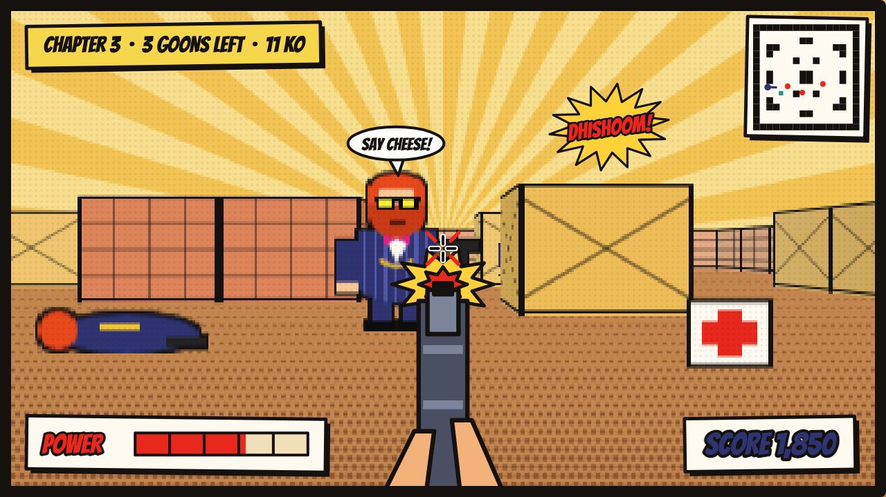
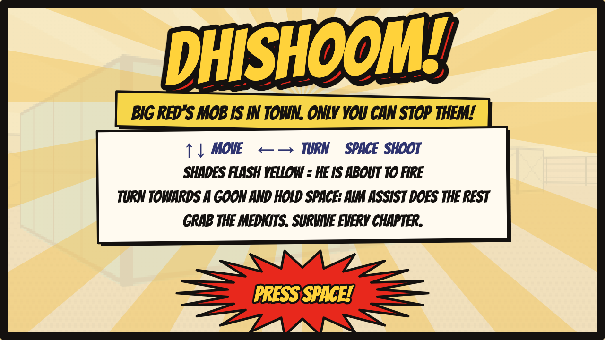
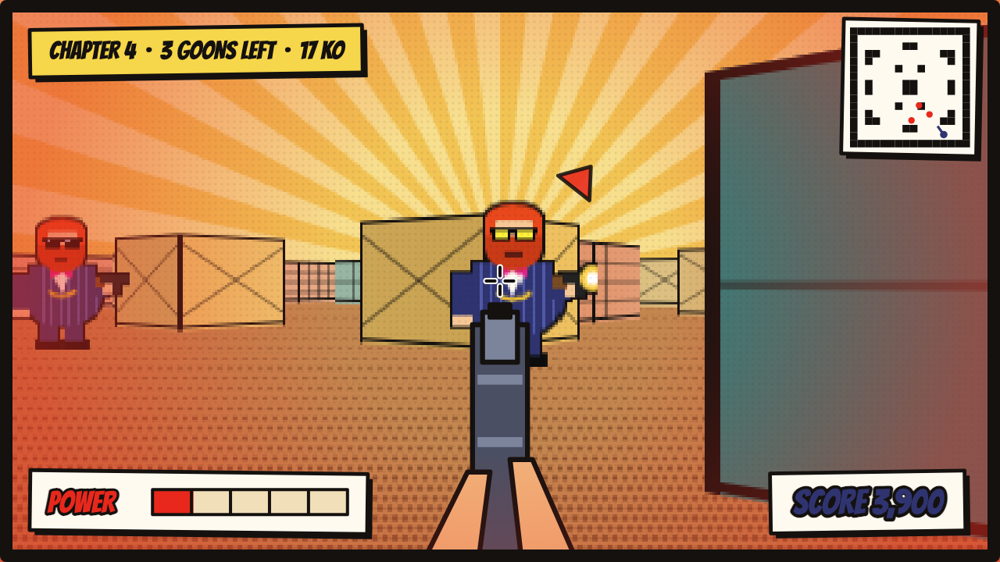
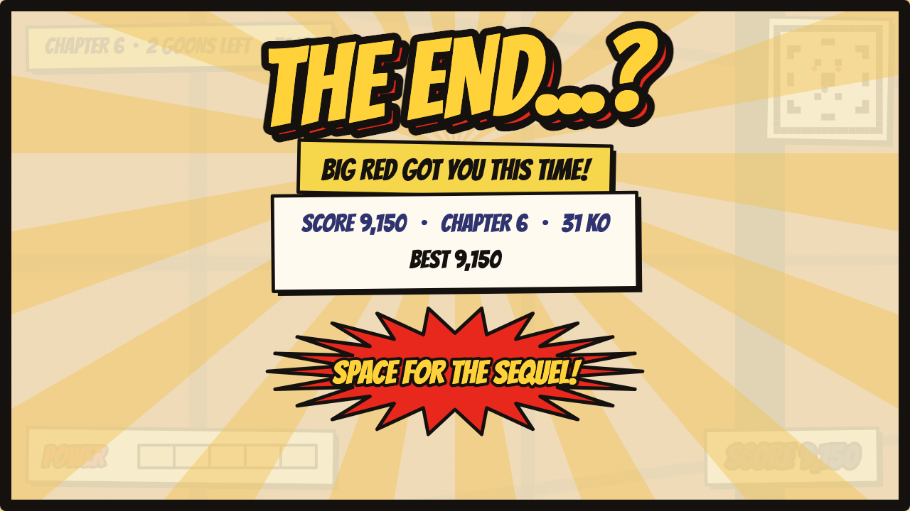

<div align="center">

# 💥 DHISHOOM!

**A comic-book first-person shooter that runs in your browser.<br>One file, zero dependencies, and Big Red's mob is in town.**

### [▶ Play now in your browser](https://iamsaikatbanerjee.github.io/shooter-game/)



</div>

---

## 🎮 How to play

You're trapped in a yard full of crates and brick walls with **Big Red's mob**: big, red-bearded goons in pinstripe suits and shades. Each **chapter** sends more of them, faster and tougher. Survive as many chapters as you can.

**Easy to pick up:** aim assist pulls your crosshair onto any goon you're roughly facing, so just turn towards them and hold <kbd>Space</kbd>.

| Key | Action |
|:---:|---|
| <kbd>↑</kbd> | Move forward |
| <kbd>↓</kbd> | Move backward |
| <kbd>←</kbd> <kbd>→</kbd> | Turn left / right |
| <kbd>Space</kbd> | **Shoot** (also starts the game and the sequel) |

That's all of it. No mouse needed.

### Survival tips

- 💬 **Read the speech balloons.** A goon about to fire shouts at you (*"Say cheese!"*, *"Too slow, hero!"*) and his **shades flash yellow**. Get out of his line of sight.
- 🧱 **Use cover.** Goons only shoot what they can see. Crates and walls block bullets both ways.
- 🔺 **Follow the red arrow.** When you get hit, an arrow points to the shooter.
- ➕ **Grab medkits.** Knocked-out goons sometimes drop one (+25 power). Finishing a chapter restores +15.
- 🗺️ **Check the map** (top right). Red dots are goons, teal squares are medkits.
- 🎯 **Hold Space and let the assist work.** Goons also miss more often from far away.

### Scoring

Each knockout is worth **100 × the chapter number**, so later chapters pay much more. Your best score is saved in your browser.

---

## 📸 Screenshots

| | |
|:---:|:---:|
|  |  |
| **The cover** | **A new chapter begins** |
|  |  |
| **Under fire, power running low** | **The End...? Press Space for the sequel** |

---

## 🎨 The look

The whole game is styled like a page from a classic newsprint comic:

- **Ink and flat colour:** every wall, goon and medkit has a black ink outline, with flat terracotta, mustard and teal "printed" colours that fade into the paper with distance.
- **Halftone everywhere:** a newsprint dot screen covers the scene, the floor uses dots that grow towards the bottom, and the sky is a comic sunburst.
- **Sound effects you can read:** hits pop up as *THAK!*, *DHAM!* and *POW!*, and knockouts as a big **DHISHOOM!** burst.
- **Comic-panel HUD:** a yellow caption box for the chapter, a POWER meter, a score panel and an outlined panel frame around the whole screen.

---

## 🚀 Ways to play

**1. Online (easiest).** Open **[iamsaikatbanerjee.github.io/shooter-game](https://iamsaikatbanerjee.github.io/shooter-game/)**. It works in any modern desktop browser.

**2. Download and play offline**
1. Click the green **Code** button above, then **Download ZIP**.
2. Unzip it and double-click `index.html`.

**3. Clone it**
```bash
git clone https://github.com/IAmSaikatBanerjee/shooter-game.git
cd shooter-game
open index.html        # macOS  (Windows: start index.html, Linux: xdg-open index.html)
```

> 💡 Click the game once if the keys don't respond, so the page has keyboard focus. It needs a keyboard, so it won't play on phones. Offline, the comic font falls back to Impact, and everything else works the same.

---

## ⚙️ How it's built

Everything lives in a single [`index.html`](index.html), written in plain JavaScript with no libraries, build step or image files.

- **Raycasting engine:** the 3D view is drawn one screen column at a time with a DDA ray-marcher (the classic 90s technique), then given flat comic shading and ink lines for each wall material.
- **Inked billboard sprites:** Big Red and the medkits are drawn in code to small canvases at startup. An automatic pass then traces a black outline around each one, and the sprites are depth-sorted and clipped against a per-column z-buffer.
- **Enemy AI:** goons find their way to you with a breadth-first-search flow field over the map grid. Once they can see you, they strafe, keep their distance from each other and warn you before every shot.
- **Hitscan combat and aim assist:** a shot uses the same screen maths as the renderer, so whatever is under the crosshair is what you hit. When you aren't turning, the aim gently swings towards the nearest visible goon within about 17° of the crosshair.
- **Comic effects layer:** sound-effect bursts, speech balloons (placed from each goon's on-screen position) and HUD panels are drawn as vector shapes at full resolution, over a low-res, crisp-pixel world.
- **Procedural audio:** gunfire, hits and pickups are synthesized live with the Web Audio API, so there are no sound files.

---

<div align="center">

Built as a portfolio project · Feedback and stars welcome ⭐

</div>
