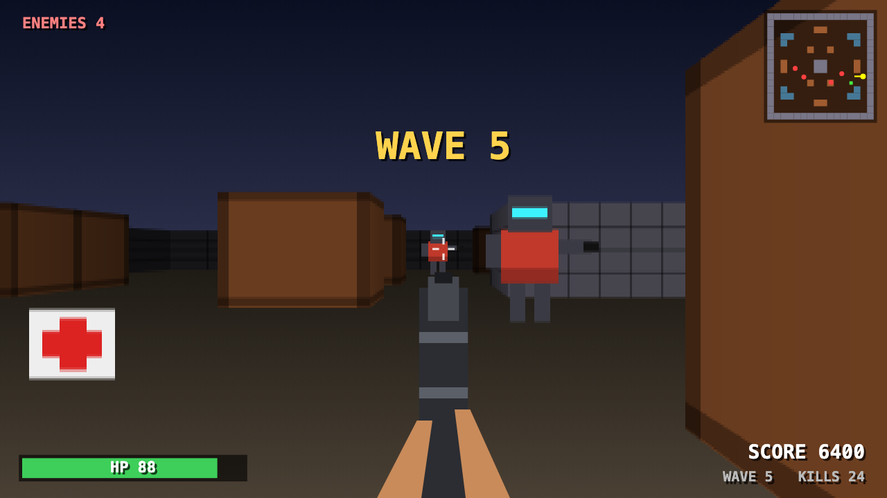

<div align="center">

# 🔫 ARENA

**A retro first-person shooter that runs in your browser. One file, zero dependencies, endless robot waves.**

### [▶ Play now in your browser](https://iamsaikatbanerjee.github.io/shooter-game/)


</div>

---

## 🎮 How to play

You're locked in an arena with combat robots. Every wave sends more of them, faster and tougher. Stay alive as long as you can.

| Key | Action |
|:---:|---|
| <kbd>↑</kbd> | Move forward |
| <kbd>↓</kbd> | Move backward |
| <kbd>←</kbd> <kbd>→</kbd> | Turn left / right |
| <kbd>Space</kbd> | **Shoot** (also starts and restarts the game) |

That's all of it. No mouse needed.

### Survival tips

- 🟡 **Watch the visor.** A bot's visor turns **yellow** for a split second before it fires. That's your cue to break line of sight.
- 🧱 **Use cover.** Bots only shoot what they can see. Pillars and crates block bullets both ways.
- 🔺 **Follow the red arrow.** When you get hit, an arrow on screen points to the shooter.
- ➕ **Grab medkits.** Destroyed bots sometimes drop one (+25 HP). Clearing a wave also restores +15 HP.
- 🗺️ **Check the minimap** (top right). Red dots are bots, green dots are medkits.
- 🎯 **Close range = easier hits** for both sides. Bots lose accuracy at a distance, and so do you if you panic.

### Scoring

Each kill is worth **100 × the current wave number**, so late waves pay much more. Your best score is saved in your browser.

---

## 📸 Screenshots

| | |
|:---:|:---:|
|  |  |
| **Title screen** | **A new wave rolls in** |
|  |  |
| **Under fire, low HP** | **Hit confirmed** |

---

## 🚀 Ways to play

**1. Online (easiest).** Open **[iamsaikatbanerjee.github.io/shooter-game](https://iamsaikatbanerjee.github.io/shooter-game/)**. It works in any modern desktop browser.

**2. Download and play offline**
1. Click the green **Code** button above, then **Download ZIP**.
2. Unzip it and double-click `index.html`.

**3. Clone it**
```bash
git clone https://github.com/IAmSaikatBanerjee/shooter-game.git
cd shooter-game
open index.html        # macOS  (Windows: start index.html, Linux: xdg-open index.html)
```

> 💡 Click the game once if the keys don't respond, so the page has keyboard focus. Needs a keyboard, so it won't play on phones.

---

## ⚙️ How it's built

Everything lives in a single [`index.html`](index.html), written in plain JavaScript with no libraries, build step or assets.

- **Raycasting engine.** The 3D view is drawn column by column with a DDA ray-marcher (the classic 90s technique), with distance fog and per-material wall detail (brick, crates, metal panels).
- **Billboard sprites.** Robots and medkits are drawn procedurally to small canvases at startup, then depth-sorted and clipped against a per-column z-buffer.
- **Enemy AI.** Bots chase you using a breadth-first-search flow field across the arena grid. When they can see you, they strafe and keep their spacing, and they telegraph each shot before firing.
- **Hitscan combat.** Your shots use the same screen projection as the renderer, so what you see under the crosshair is what you hit.
- **Procedural audio.** Gunfire, hits and pickups are synthesized live with the Web Audio API, so there are no sound files.
- **Low-res, crisp HUD.** The world renders at 400×225 and is upscaled with sharp pixels, while the HUD renders at full resolution.

---

<div align="center">

Built as a portfolio project · Feedback and stars welcome ⭐

</div>
